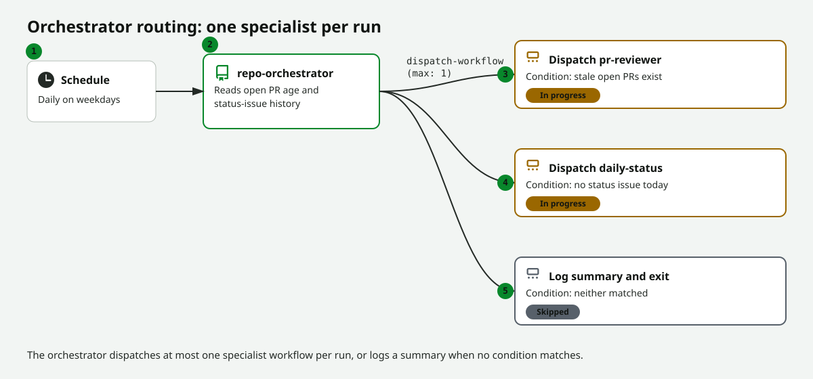

<!-- page-journey: all -->
<!-- page-adventure: advanced -->
<!--
<research-metadata>
  <focus>Multi-workflow orchestration using the dispatch-workflow safe-output operation in gh-aw to compose individual specialist workflows into a coordinated pipeline</focus>
  <sources>
    <source>https://github.github.com/gh-aw/llms.txt</source>
    <source>https://github.github.com/gh-aw/reference/safe-outputs/</source>
    <source>https://github.github.com/gh-aw/guides/reusing-workflows/</source>
  </sources>
  <rationale>The workshop curriculum covers building individual workflows with sub-agents, memory, MCP tools, evals, and cost controls. No step teaches learners to compose those workflows into a pipeline — one orchestrator that reads repository state and activates the right specialist. The dispatch-workflow safe-output makes this possible, but it does not appear anywhere in the existing content. Learners who complete all prior steps can build capable individual workflows yet have no model for how to chain them. This step closes that gap with a concrete, practitioner-ready pattern.</rationale>
</research-metadata>
-->

# Orchestrate Multiple Agentic Workflows

> _Chain your specialist workflows together — one orchestrator reads the situation, the right specialist takes action._

## :dart: What You'll Do

You'll build an orchestrator workflow that reads repository state, decides which specialist workflow to activate, and dispatches it using the [`dispatch-workflow`](https://github.github.com/gh-aw/reference/safe-outputs/) safe-output. By the end of this step, you'll have a coordinator that routes work to existing specialists rather than handling everything itself.

## :clipboard: Before You Start

- You completed [Verify Your Workflow Quality with Evals](27-evaluate-workflow-quality.md).
- You have at least two working agentic workflows (for example, your `daily-status` workflow and a PR reviewer from [Build Your First Event-Driven Workflow](14b-pr-reviewer-workflow.md)).
- You can compile workflows with `gh aw compile` from [Using `gh aw compile` to Catch Errors Early](side-quest-07-01-compile-workflow.md).

## Understand workflow orchestration

When a repository needs different kinds of AI work — status reports, PR reviews, cost audits — you can keep each concern in its own focused workflow. An orchestrator connects them: it reads signals from the repository and dispatches the right specialist.

The key primitive is `dispatch-workflow` in [`safe-outputs`](https://github.github.com/gh-aw/reference/safe-outputs/). It lets your orchestrator trigger another workflow in the same repository and optionally pass inputs to it.

You can optionally explore [Agents Trigger Agents](https://github.github.com/gh-aw/cracktro/#agents-trigger-agents) in the interactive presentation (cracktro) to trace safe-output dispatches and completion signals across separate workflow runs.

<picture>
   <source media="(prefers-color-scheme: dark)" srcset="images/28-orchestrator-routing-dark.svg">
   <source media="(prefers-color-scheme: light)" srcset="images/28-orchestrator-routing-light.svg">
   
</picture>

> :thinking: **Predict:** Look at your existing workflows. Which one handles the broadest task? Which handles the narrowest? The broadest is a natural orchestration candidate; the narrowest is a natural specialist.

## Steps

### Design your orchestrator

Before writing code, decide:

- What signals will the orchestrator read? (open issues count, PR age, recent commit activity, or a combination)
- Which specialist workflows will it activate? (at most one per run keeps behavior predictable)
- What condition routes to each specialist?

A simple decision table helps:

| Signal | Action |
|--------|--------|
| Stale open PRs exist | Dispatch the PR reviewer |
| No status issue created today | Dispatch the daily-status reporter |
| Neither condition | Log a summary and exit |

### Create the orchestrator workflow

In your AI agent, run:

```prompt
/agentic-workflows create a new workflow named `repo-orchestrator` that reads
open PR count and checks whether a daily-status issue exists today.
If stale open PRs are found, use dispatch-workflow to trigger `pr-reviewer`.
If no status issue exists, use dispatch-workflow to trigger `daily-status`.
Add permissions: contents: read, issues: read, pull-requests: read.
Set safe-outputs: dispatch-workflow with the list of allowed workflows.
```

> [!TIP]
> **Optional Side Quest:** Prefer to write the orchestrator by hand, or want to understand the `dispatch-workflow` allowlist and `max` cap? Take the optional [Side Quest: Write and Review a `dispatch-workflow` Orchestrator](side-quest-28-01-dispatch-workflow.md), then return here.

### Review the `dispatch-workflow` safe-output

Confirm the generated frontmatter has a `dispatch-workflow` safe-output with an explicit `workflows` allowlist and `max: 1`. The allowlist limits which specialists the orchestrator can trigger, and `max: 1` keeps each run to a single dispatch.

### Compile and push

```bash
gh aw compile repo-orchestrator
git add .
git commit -m "feat: add repo-orchestrator workflow"
git push
```

### Run and verify routing

Trigger a manual run from the Actions UI:

1. Open **Actions** → **Repository Orchestrator** → **Run workflow**.
2. After the run completes, open the run log.
3. Confirm the orchestrator identified a condition and dispatched the correct specialist.
4. Open **Actions** and verify the specialist workflow was triggered as a separate run.

If neither condition matched, the orchestrator should log a one-line summary and exit — confirm that no specialist was dispatched.

### Iterate on routing logic

Return to your agent and refine the conditions:

```prompt
/agentic-workflows update repo-orchestrator to also dispatch `daily-status` when
the latest commit is more than 48 hours old and no status issue was created today.
```

Each iteration follows the same loop: edit the brief, compile, push, run, inspect the dispatch log.

## :white_check_mark: Checkpoint

- [ ] You identified at least two specialist workflows and one orchestration condition for each
- [ ] Your `repo-orchestrator.md` includes a `dispatch-workflow` safe-output with an explicit `workflows` allowlist
- [ ] `gh aw compile repo-orchestrator` succeeds
- [ ] A manual run of the orchestrator produced a log showing which condition was evaluated
- [ ] You verified the specialist workflow was triggered (or confirmed it was correctly skipped when no condition matched)
- [ ] You can explain why `max: 1` in the `dispatch-workflow` block keeps orchestrator behavior predictable

<!-- journey: all -->
**Next:** [Teach Your Agent Domain Knowledge with Skills](29-skills-and-domain-knowledge.md)
<!-- /journey -->
