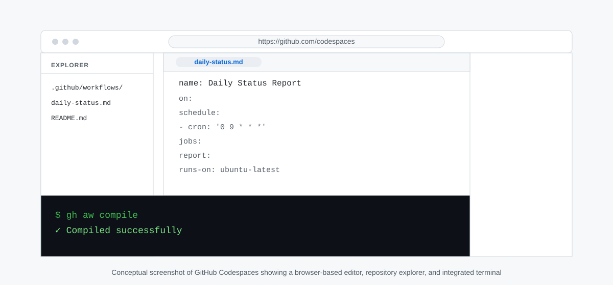
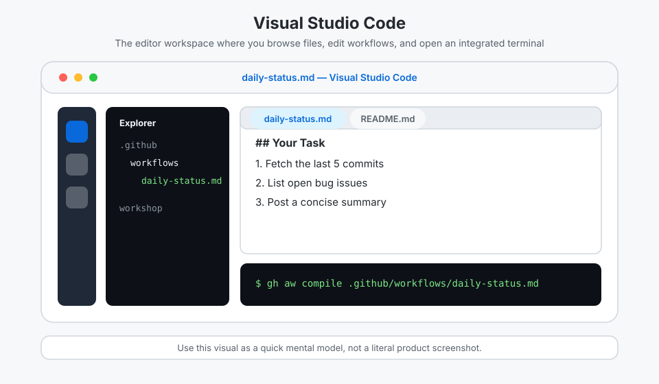
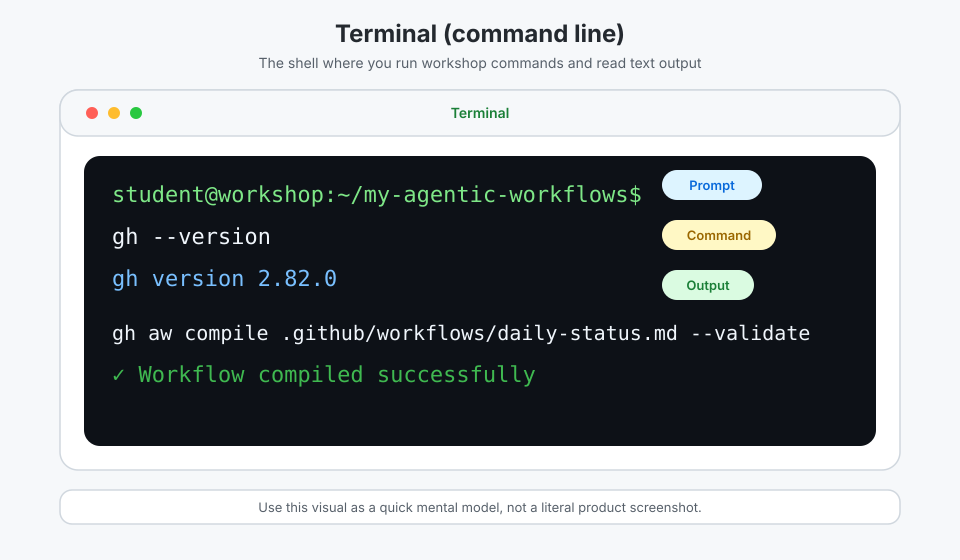
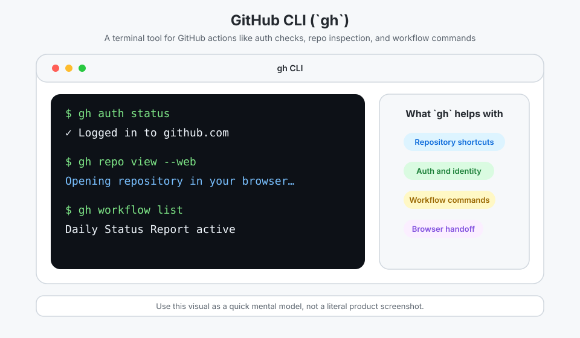
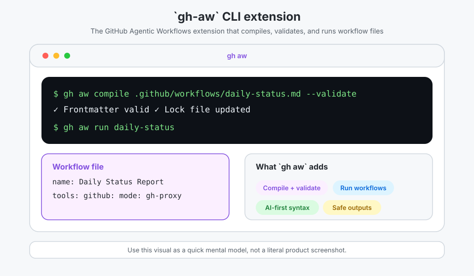
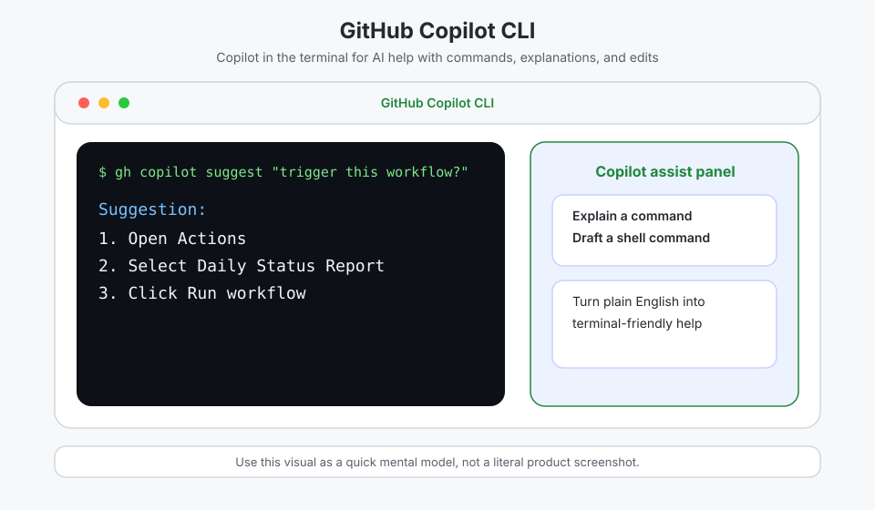
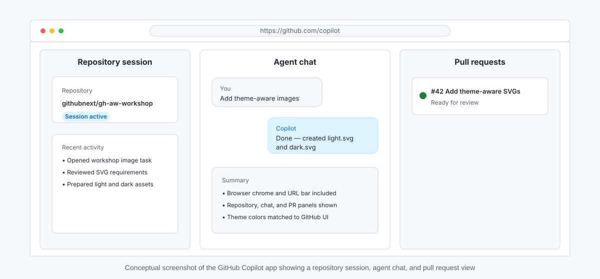
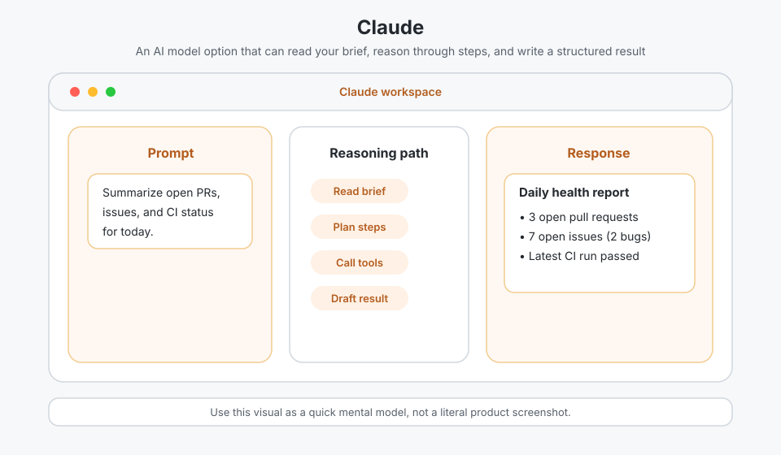
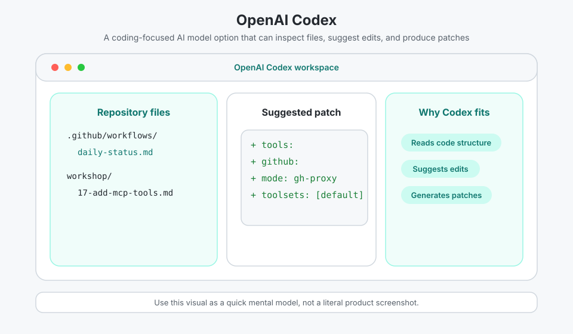

<!-- page-journey: all -->
<!-- page-adventure: side-quest -->
# Side Quest: Environment Screenshots

> _Optional: recognize what each workshop environment and tool looks like on screen._

**What you'll learn:** By the end of this page you can recognize each environment, tool, and model option the workshop mentions, and match it to the one-line role shown under its picture.

## :clipboard: Before You Start

You don't need a terminal for this page. For the glossary of terms and the tool verification commands, see [Environment Reference](side-quest-01-02-environment-reference.md).

These visuals are simplified mental models, not literal product screenshots.

## Development environments

### GitHub Codespaces

<picture>
  <source media="(prefers-color-scheme: dark)" srcset="images/side-quest-01-02-github-codespaces-dark.svg">
  <source media="(prefers-color-scheme: light)" srcset="images/side-quest-01-02-github-codespaces-light.svg">
  
</picture>

You use Codespaces when you want a ready-to-go development environment in your browser.

### Visual Studio Code (VS Code)

<picture>
  <source media="(prefers-color-scheme: dark)" srcset="images/side-quest-01-02-vscode-dark.svg">
  <source media="(prefers-color-scheme: light)" srcset="images/side-quest-01-02-vscode-light.svg">
  
</picture>

You use VS Code to browse files, edit workflows, and keep a terminal open beside your work.

### Terminal (command line)

<picture>
  <source media="(prefers-color-scheme: dark)" srcset="images/side-quest-01-02-terminal-dark.svg">
  <source media="(prefers-color-scheme: light)" srcset="images/side-quest-01-02-terminal-light.svg">
  
</picture>

You use the terminal whenever the workshop asks you to run `gh`, `gh aw`, or `git` commands.

## Workshop tools and model options

### GitHub CLI (`gh`)

<picture>
  <source media="(prefers-color-scheme: dark)" srcset="images/side-quest-01-02-gh-cli-dark.svg">
  <source media="(prefers-color-scheme: light)" srcset="images/side-quest-01-02-gh-cli-light.svg">
  
</picture>

You use `gh` for GitHub-specific terminal tasks like authentication checks, repository shortcuts, and workflow commands.

### `gh-aw` CLI extension

<picture>
   <source media="(prefers-color-scheme: dark)" srcset="images/side-quest-01-02-gh-aw-dark.svg">
   <source media="(prefers-color-scheme: light)" srcset="images/side-quest-01-02-gh-aw-light.svg">
   
</picture>

You use `gh aw` to compile agentic workflow files.

### GitHub Copilot CLI

<picture>
  <source media="(prefers-color-scheme: dark)" srcset="images/side-quest-01-02-copilot-cli-dark.svg">
  <source media="(prefers-color-scheme: light)" srcset="images/side-quest-01-02-copilot-cli-light.svg">
  
</picture>

You use GitHub Copilot CLI when you want AI help inside the terminal.

### GitHub Copilot app

<picture>
  <source media="(prefers-color-scheme: dark)" srcset="images/side-quest-01-02-copilot-app-dark.svg">
  <source media="(prefers-color-scheme: light)" srcset="images/side-quest-01-02-copilot-app-light.svg">
  
</picture>

You use the GitHub Copilot app when you want to start and steer repository sessions, manage coding tasks, and review pull requests from a Copilot workspace.

### Claude

<picture>
  <source media="(prefers-color-scheme: dark)" srcset="images/side-quest-01-02-claude-dark.svg">
  <source media="(prefers-color-scheme: light)" srcset="images/side-quest-01-02-claude-light.svg">
  
</picture>

You may see Claude as one of the AI model options that can read a brief, reason through a task, and produce an output.

### OpenAI Codex

<picture>
  <source media="(prefers-color-scheme: dark)" srcset="images/side-quest-01-02-openai-codex-dark.svg">
  <source media="(prefers-color-scheme: light)" srcset="images/side-quest-01-02-openai-codex-light.svg">
  
</picture>

You may see OpenAI Codex as a coding-focused model option that reads files and suggests edits.

## :white_check_mark: Checkpoint

- [ ] You can point to which picture shows the environment where you edit files (Codespaces or VS Code)
- [ ] You can name the tool you use to run `gh aw` commands (the terminal)
- [ ] You can tell the Copilot CLI apart from the Copilot app
- [ ] You know which entries are AI model options (Claude, OpenAI Codex) rather than tools you install

When you're done here, return to [Environment Reference](side-quest-01-02-environment-reference.md).
