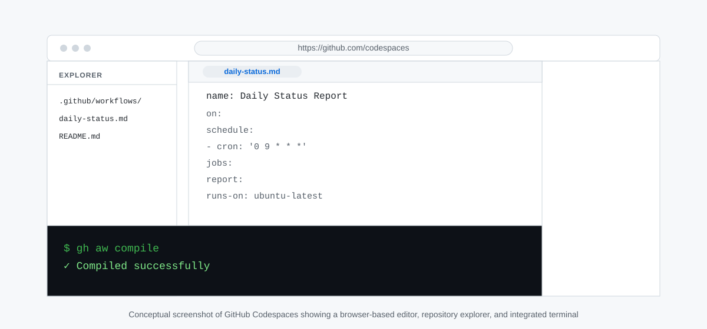
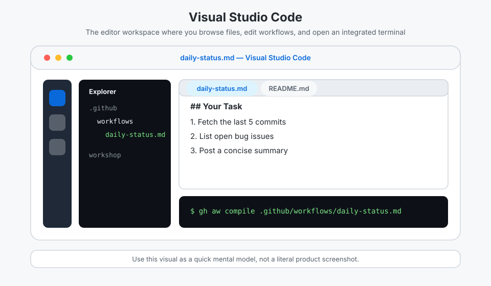
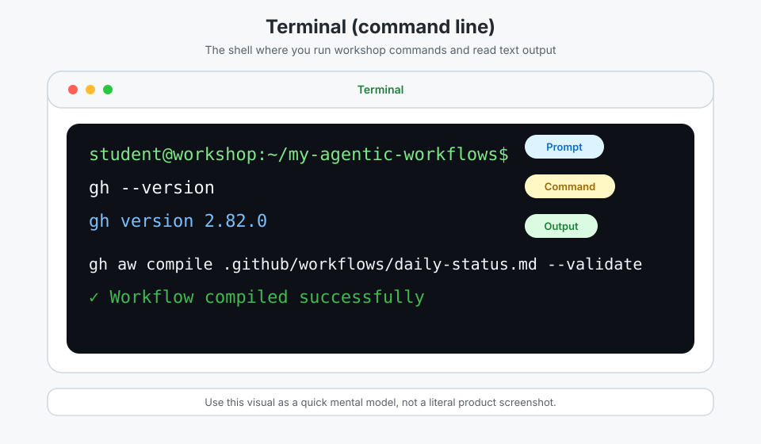
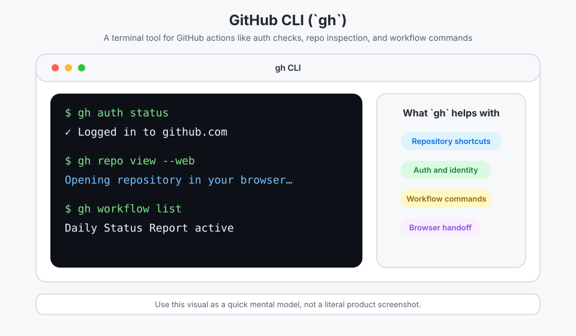
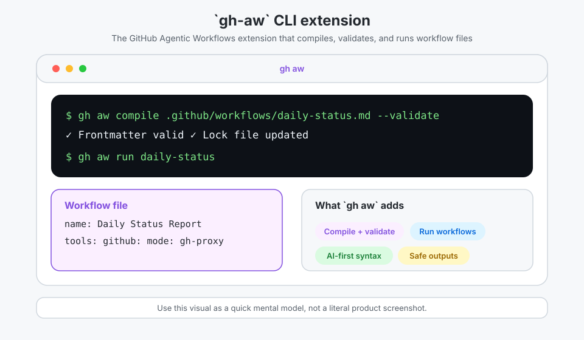
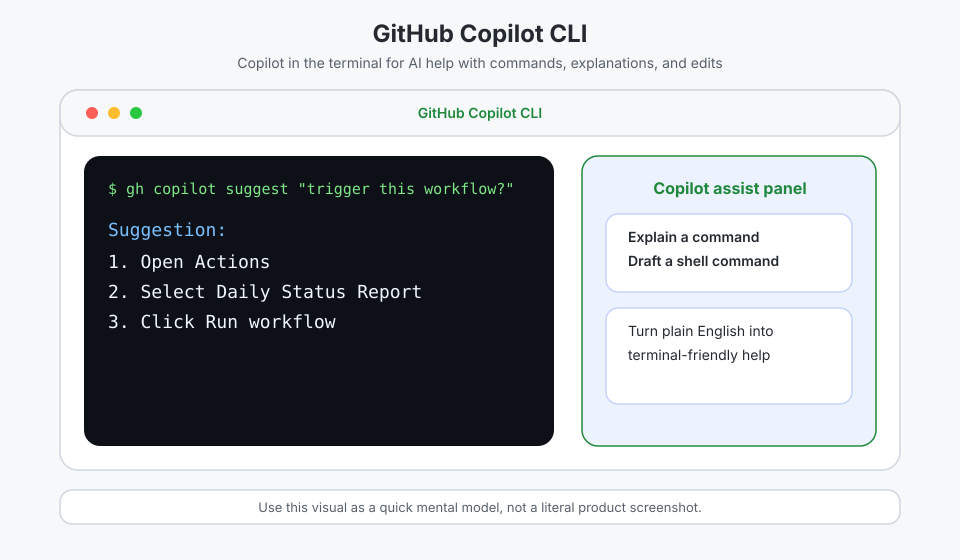
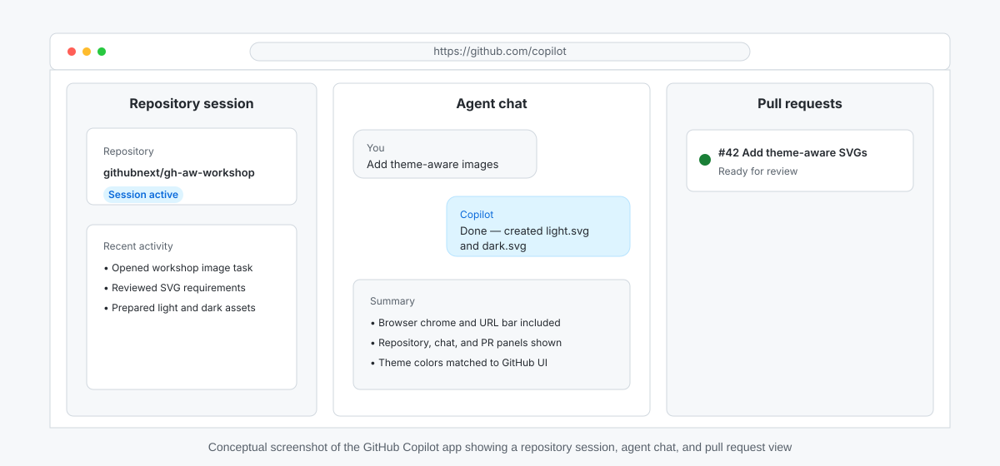
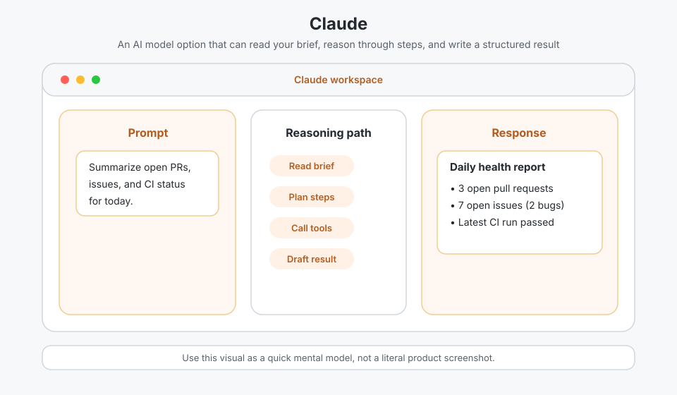
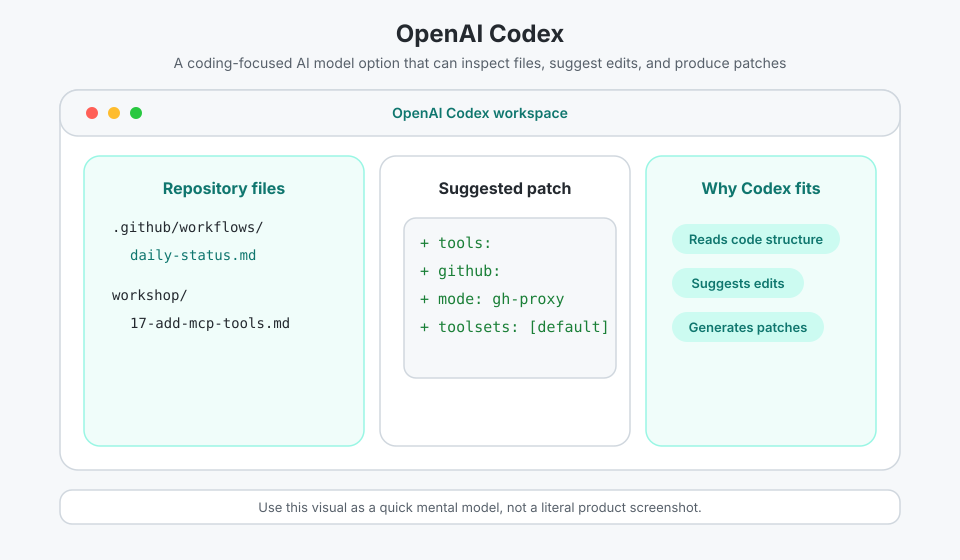

<!-- page-journey: all -->
<!-- page-adventure: side-quest -->
# Side Quest: Environment Screenshots

> _Optional: recognize what each workshop environment and AI tool looks like on screen._

**What you'll learn:** By the end of this page you can identify each environment and tool from its screenshot and say when you'll use it.

## :clipboard: Before You Start

This is a visual companion to the [Environment Reference](side-quest-01-02-environment-reference.md) glossary. You can read it any time. No terminal required.

## Conceptual screenshots

These visuals are simplified mental models, not literal product screenshots. Use them to recognize what each name refers to when workshop instructions say "open a terminal" or "use the Copilot app."

### Development environments

#### GitHub Codespaces

<picture>
  <source media="(prefers-color-scheme: dark)" srcset="images/side-quest-01-02-github-codespaces-dark.svg">
  <source media="(prefers-color-scheme: light)" srcset="images/side-quest-01-02-github-codespaces-light.svg">
  
</picture>

You use Codespaces when you want a ready-to-go development environment in your browser.

#### Visual Studio Code (VS Code)

<picture>
  <source media="(prefers-color-scheme: dark)" srcset="images/side-quest-01-02-vscode-dark.svg">
  <source media="(prefers-color-scheme: light)" srcset="images/side-quest-01-02-vscode-light.svg">
  
</picture>

You use VS Code to browse files, edit workflows, and keep a terminal open beside your work.

#### Terminal (command line)

<picture>
  <source media="(prefers-color-scheme: dark)" srcset="images/side-quest-01-02-terminal-dark.svg">
  <source media="(prefers-color-scheme: light)" srcset="images/side-quest-01-02-terminal-light.svg">
  
</picture>

You use the terminal whenever the workshop asks you to run `gh`, `gh aw`, or `git` commands.

### Workshop tools and model options

#### GitHub CLI (`gh`)

<picture>
  <source media="(prefers-color-scheme: dark)" srcset="images/side-quest-01-02-gh-cli-dark.svg">
  <source media="(prefers-color-scheme: light)" srcset="images/side-quest-01-02-gh-cli-light.svg">
  
</picture>

You use `gh` for GitHub-specific terminal tasks like authentication checks, repository shortcuts, and workflow commands.

#### `gh-aw` CLI extension

<picture>
   <source media="(prefers-color-scheme: dark)" srcset="images/side-quest-01-02-gh-aw-dark.svg">
   <source media="(prefers-color-scheme: light)" srcset="images/side-quest-01-02-gh-aw-light.svg">
   
</picture>

You use `gh aw` to compile agentic workflow files.

#### GitHub Copilot CLI

<picture>
  <source media="(prefers-color-scheme: dark)" srcset="images/side-quest-01-02-copilot-cli-dark.svg">
  <source media="(prefers-color-scheme: light)" srcset="images/side-quest-01-02-copilot-cli-light.svg">
  
</picture>

You use GitHub Copilot CLI when you want AI help inside the terminal.

#### GitHub Copilot app

<picture>
  <source media="(prefers-color-scheme: dark)" srcset="images/side-quest-01-02-copilot-app-dark.svg">
  <source media="(prefers-color-scheme: light)" srcset="images/side-quest-01-02-copilot-app-light.svg">
  
</picture>

You use the GitHub Copilot app when you want to start and steer repository sessions, manage coding tasks, and review pull requests from a Copilot workspace.

#### Claude

<picture>
  <source media="(prefers-color-scheme: dark)" srcset="images/side-quest-01-02-claude-dark.svg">
  <source media="(prefers-color-scheme: light)" srcset="images/side-quest-01-02-claude-light.svg">
  
</picture>

You may see Claude as one of the AI model options that can read a brief, reason through a task, and produce an output.

#### OpenAI Codex

<picture>
  <source media="(prefers-color-scheme: dark)" srcset="images/side-quest-01-02-openai-codex-dark.svg">
  <source media="(prefers-color-scheme: light)" srcset="images/side-quest-01-02-openai-codex-light.svg">
  
</picture>

You may see OpenAI Codex as a coding-focused model option that reads files and suggests edits.

## Try it: match the screen to the tool

Look back at the Codespaces, Terminal, and Copilot CLI screenshots. For each one, write down the one visual clue that told you which tool it was (for example, a file explorer, a command prompt, or an agent chat pane). Then open your own Codespace and find the same clue.

<!-- journey: all -->
## :white_check_mark: Checkpoint

- [ ] You can match each item to its conceptual screenshot
- [ ] You named one visual clue for Codespaces, Terminal, and Copilot CLI
- [ ] You found the same clue in your own Codespace
- [ ] You know the Copilot app is optional and where its screenshot lives

When you're done here, return to the [Environment Reference](side-quest-01-02-environment-reference.md).
<!-- /journey -->
