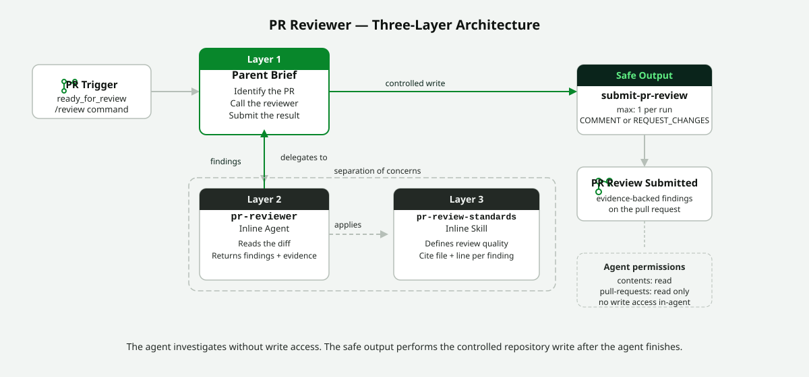

<!-- page-journey: all -->
<!-- page-adventure: side-quest -->
# Side Quest: The Agent and Skill Split

> _Optional: a closer look at why `pr-reviewer.md` separates orchestration, investigation, and review standards into three layers — and when to reuse the same split in your own workflows._

## :dart: What You'll Do

Walk through the three-layer design behind the PR reviewer workflow — parent brief, inline agent, and inline skill — and practice sorting instructions into the right layer. By the end, you'll know which layer to edit when you want to change *how* a workflow investigates versus *what* it considers a good result.

## :clipboard: Before You Start

- You are starting or have started [Build a PR Reviewer with an Agent and Skill](14b-pr-reviewer-workflow.md).
- You're comfortable with the basic idea of an [inline sub-agent](https://github.github.com/gh-aw/reference/inline-sub-agents/) from earlier steps.

## Steps

### Understand the three layers

The parent workflow should coordinate a run, not contain every review rule. It delegates diff analysis to a focused inline agent. That agent applies an inline skill containing the review method.

| Part | Responsibility |
|---|---|
| Parent brief | Identify the pull request, call the reviewer, and submit the result |
| `pr-reviewer` agent | Read the diff and return prioritized, evidence-backed findings |
| `pr-review-standards` skill | Define what counts as a useful finding and how to format it |

The diagram below shows how these three layers connect at runtime, with the safe output performing the only repository write.

<picture>
  <source srcset="images/14b-pr-reviewer-layers-dark.svg" media="(prefers-color-scheme: dark)">
  
</picture>

### See why the split pays off

The agent can change *how* it investigates a pull request without changing the stable standards in the skill. You can also improve the skill without making the parent brief longer. The same split makes it straightforward to extend the reviewer to apply labels based on which files changed (see [Pattern: Auto-Label PRs by Content](side-quest-13-01-pr-labeler-pattern.md)) or to post a structured summary that doubles as a release note draft (see [Pattern: Generate a PR Summary Comment](side-quest-13-02-pr-summary-pattern.md)).

### Practice: sort the instruction into a layer

> :thinking: **Predict:** Which instruction belongs in the skill: "review pull request 42" or "cite a changed file and line for every finding"?

Reveal the answer

"Review pull request 42" is run-specific orchestration — it belongs in the parent brief, which identifies *which* pull request to act on for this run. "Cite a changed file and line for every finding" is reusable review guidance that should hold for every review regardless of which pull request triggered it — it belongs in the `pr-review-standards` skill.

Try one more on your own: where would "use the `small` model to keep per-review cost low" belong? (Answer: the `pr-reviewer` agent's own frontmatter — a per-agent setting, not a standard or an orchestration detail.)

## :white_check_mark: Checkpoint

- [ ] You can name the three layers and state each one's responsibility in one sentence
- [ ] You correctly sorted both practice instructions into their layer
- [ ] You can explain why keeping standards in the skill makes the parent brief easier to read

**Return to the main adventure:** [Build a PR Reviewer with an Agent and Skill](14b-pr-reviewer-workflow.md)
