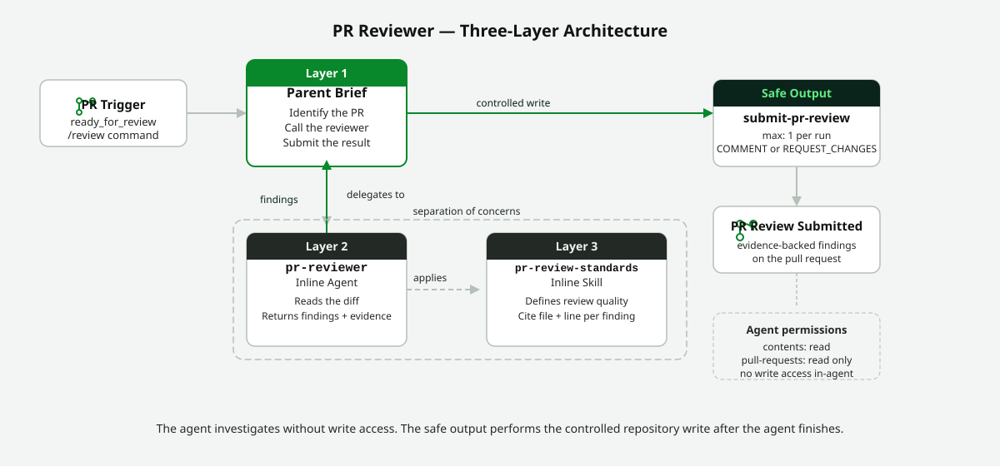

<!-- page-journey: all -->
<!-- page-adventure: side-quest -->
# Side Quest: The Agent and Skill Split

> _Learn why a PR reviewer works best as three small layers — a parent brief, an agent, and a skill — instead of one long prompt._

## :dart: What You'll Do

You'll read how the parent brief, the `pr-reviewer` agent, and the `pr-review-standards` skill divide responsibility, see how they connect at runtime, and practice deciding which layer an instruction belongs in.

## :clipboard: Before You Start

- You are working through [Build a PR Reviewer with an Agent and Skill](14b-pr-reviewer-workflow.md), or you have read its introduction.

## Steps

### Meet the three layers

The parent workflow should coordinate the run, not contain every review rule. It delegates the diff analysis to a focused [inline agent](https://github.github.com/gh-aw/reference/inline-sub-agents/). That agent applies an inline skill containing the review method.

| Part | Responsibility |
|---|---|
| Parent brief | Identify the pull request, call the reviewer, and submit the result |
| `pr-reviewer` agent | Read the diff and return prioritized, evidence-backed findings |
| `pr-review-standards` skill | Define what counts as a useful finding and how to format it |

The diagram below shows how these three layers connect at runtime, with the safe output performing the only repository write.

<picture>
  <source srcset="images/14b-pr-reviewer-layers-dark.svg" media="(prefers-color-scheme: dark)">
  
</picture>

### Why the split helps

The agent can change how it investigates a pull request without changing the stable standards in the skill. You can also improve the skill without making the parent brief longer. The same split makes it straightforward to extend the reviewer to apply labels based on which files changed (see [Pattern: Auto-Label PRs by Content](side-quest-13-01-pr-labeler-pattern.md)) or to post a structured summary that doubles as a release note draft (see [Pattern: Generate a PR Summary Comment](side-quest-13-02-pr-summary-pattern.md)).

> :thinking: **Predict:** Which instruction belongs in the skill: “review pull request 42” or “cite a changed file and line for every finding”? The first is run-specific orchestration; the second is reusable review guidance.

## :white_check_mark: Checkpoint

- [ ] You can describe what the parent brief, agent, and skill each do
- [ ] You can explain why the safe output is the only layer that writes to the repository
- [ ] You can decide whether a new instruction belongs in the brief or in the skill

<!-- journey: all -->
**Return to the main adventure:** [Build a PR Reviewer with an Agent and Skill](14b-pr-reviewer-workflow.md)
<!-- /journey -->
