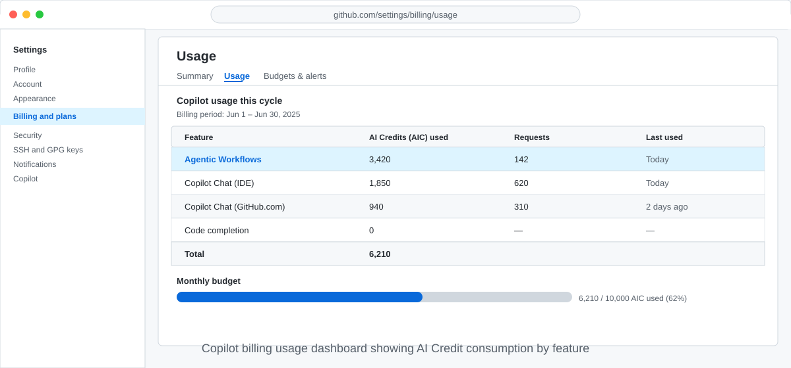

<!-- page-journey: all -->
<!-- page-adventure: side-quest -->
# Side Quest: Check Your AIC Usage and Estimate Monthly Cost

> _Optional: find your real AI Credit usage in the billing dashboard and turn recent run data into a monthly cost estimate you can share with your administrator._

## :dart: What You'll Do

You'll locate your AI Credit (AIC) consumption in the GitHub billing dashboard, read per-run AIC with `gh aw logs`, and calculate a monthly cost estimate for a scheduled workflow.

## :clipboard: Before You Start

- You read the [Understand AI Credits](26-manage-costs-and-budgets.md) section of Manage Costs and AI Credit Budgets.
- You have run your workflow at least once so `gh aw logs` has data to show.

## Steps

### Check current usage in the billing dashboard

1. Open **github.com** and click your profile picture → **Settings**.
2. In the left sidebar, click **Billing and plans**.
3. Scroll to the **Copilot** section and click **Usage**.
4. Look for the **Agentic Workflows** row. It shows AIC consumed this billing cycle.

<picture>
  <source media="(prefers-color-scheme: dark)" srcset="images/26-billing-dashboard-dark.svg">
  <source media="(prefers-color-scheme: light)" srcset="images/26-billing-dashboard-light.svg">
  
</picture>

### Estimate monthly cost for a scheduled workflow

Use the per-run cost from `gh aw logs` to project monthly spend.

```bash
gh aw logs daily-status --count 5
```

Look at the **AIC** column. Average the last five runs, then multiply:

```text
monthly cost = average AIC per run × runs per day × 30
```

If your workflow averages 1.5 AIC and runs once a day: `1.5 × 1 × 30 = 45 AIC per month`. Share this estimate with your GitHub administrator before enabling a high-frequency [schedule](https://github.github.com/gh-aw/reference/triggers/#scheduled-triggers-schedule).

## :white_check_mark: Checkpoint

- [ ] You located your AIC usage for this billing cycle in the GitHub billing dashboard
- [ ] You calculated an estimated monthly AIC cost for your scheduled workflow

<!-- journey: all -->
**Return to the main adventure:** [Manage Costs and AI Credit Budgets](26-manage-costs-and-budgets.md)
<!-- /journey -->
